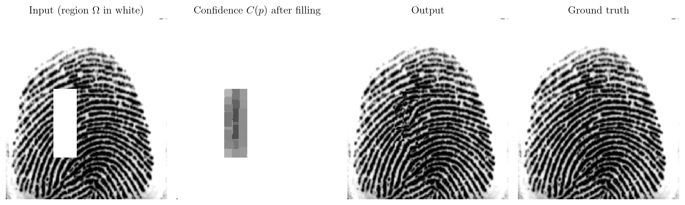
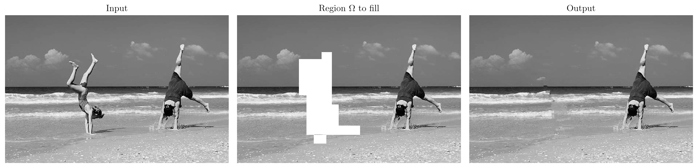

<div align="center">

# 🧩 patch-based-inpainting 🧩

**Exemplar-based image inpainting in C++/OpenCV, following the patch-priority algorithm of Criminisi, Pérez and Toyama (2004), with interactive region selection, rotations and convolutions.**

C++17 · OpenCV · OpenMP-parallel patch search · interactive polygon selection

<br>

<table>
  <tr>
    <td align="center" valign="top" width="260">
      <a href="https://github.com/maximilien-mahdhi"></a><br>
      <b>Maximilien MAHDHI</b><br>
      <sub>Design and implementation</sub><br>
      <sub><a href="https://github.com/maximilien-mahdhi">GitHub</a> · <a href="https://www.linkedin.com/in/maximilien-mahdhi">LinkedIn</a></sub>
    </td>
  </tr>
</table>

<br>


<br>



<sub><code>./build/main -i test_images/fingerprint_hole.png 73 49 72 143 49</code> — input, confidence map after filling, output and ground truth</sub>

</div>

<br>

> [!NOTE]
> This repository comes from a 2-month image-processing project carried out in December 2024 during my M1 MSIAM at Université Grenoble Alpes (Ensimag).

<br>

---

## Table of contents

- [Overview](#overview)
- [Installation](#installation)
- [Usage](#usage)
- [Results](#results)
- [Algorithm](#algorithm)
- [Project structure](#project-structure)
- [Design notes and limitations](#design-notes-and-limitations)
- [References](#references)

---

## Overview

*Inpainting* reconstructs a missing or unwanted region $`\Omega`$ of an image from the rest of the image. Exemplar-based methods fill $`\Omega`$ patch by patch, by copying the most similar patches found in the known region. The order in which the patches are filled is what preserves the structures : the algorithm of Criminisi et al. gives priority to patches that are well known and crossed by strong edges, so that lines are propagated before flat textures.

<br>

| Feature | Description |
| --- | --- |
| **Region-filling inpainting** | removes a polygonal region and rebuilds it patch by patch, strong edges first |
| **Interactive selection** | the polygon is drawn with the mouse, with live feedback ; coordinates can also be passed on the command line |
| **Rotations** | rigid rotation, and an experimental elastic rotation whose strength decreases with the distance to a centre |
| **Convolutions** | named kernels : Sobel, Prewitt, Laplacian, box blur, Gaussian |
| **OpenMP** | the exhaustive patch search, the bottleneck of the method, runs on all cores |

<br>

**Main results**

- **Structures are propagated across the hole.** On the fingerprint, the ridges entering $`\Omega`$ from both sides are continued through it, and the result is visually close to the ground truth.
- **Objects are removed cleanly from natural scenes.** On the beach scene, the gymnast and the reflection of her hands disappear, and the horizon, the waves and the sand are continued through the hole.
- **The run time is dominated by the patch search.** About $`0.25`$ s for the $`187 \times 166`$ fingerprint and $`30`$ s for the $`408 \times 612`$ beach scene on 2 cores, where OpenMP gives a $`1.7\times`$ speed-up.

<br>

---

## Installation

You need a C++17 compiler, OpenCV 4 (core, imgproc, highgui, found through `pkg-config`), OpenMP and `make`.

```bash
git clone https://github.com/maximilien-mahdhi/patch-based-inpainting.git
cd patch-based-inpainting
make                                                 # builds build/main
```

The `Makefile` targets macOS (Apple clang with Homebrew's `libomp`). On Linux, override the compiler and the OpenMP flags :

```bash
make CXX=g++ OMP_CFLAGS=-fopenmp OMP_LIBS=-fopenmp
```

<details>
<summary><b>Platform-specific setup</b></summary>

<br>

**macOS**

```bash
brew install opencv libomp pkg-config
```

**Debian / Ubuntu**

```bash
sudo apt install build-essential libopencv-dev pkg-config     # GCC ships with OpenMP (libgomp)
```

</details>

<br>

---

## Usage

```
./build/main <flag> <image_path> [parameters]
```

| Flag | Purpose | Parameters | Example |
| --- | --- | --- | --- |
| `-help` | list the flags | — | `./build/main -help` |
| `-i` | region-filling inpainting | polygon coordinates (optional : interactive selection otherwise) | `./build/main -i test_images/beach.png` |
| `-r` | rigid rotation | angle in degrees | `./build/main -r test_images/Bird.png 60` |
| `-er` | elastic rotation | angle in degrees | `./build/main -er test_images/Bird.png 60` |
| `-conv` | convolution | kernel name | `./build/main -conv test_images/beach.png sobelX` |

All outputs are written to `output_images/`, created on first run.

<br>

### Inpainting (`-i`)

**Interactive selection** — run `-i` without coordinates and click the vertices of the polygon on the image :

```bash
./build/main -i test_images/fingerprint_hole.png
```

| Key | Action |
| --- | --- |
| `Enter` | confirm the selection and run the inpainting |
| `Backspace` | undo the last point |
| `Escape` | cancel |

Edges alternate between horizontal and vertical, starting with a horizontal one. The closing edge is vertical, so the last vertex must share the column of the first one ; the preview shows it in green when it does, in orange otherwise.

**Coordinates on the command line** — the polygon is given in a compact form : the first vertex $`(r_1, c_1)`$, then one value per edge, alternately the column reached by a horizontal edge and the row reached by a vertical edge.

```bash
./build/main -i test_images/fingerprint_hole.png 73 49 72 143 49
```

Here the polygon is $`(73, 49) \to (73, 72) \to (143, 72) \to (143, 49)`$, closed by the vertical edge back to $`(73, 49)`$ : the rectangle of rows $`73`$ to $`143`$ and columns $`49`$ to $`72`$.

```bash
./build/main -i test_images/beach.png 121 169 231 102 258 246 277 305 335 329 243 353 210 329 190 220 169
```

Images are processed in grayscale. The run writes `before_recovering.png`, `initial_image.png`, `image_hole.png` (region $`\Omega`$ in white), `confidence_image.png` and the result `region_filling_output.png`, plus `selection_preview.png` in interactive mode.

<br>

### Rotations (`-r`, `-er`)

```bash
./build/main -r  test_images/Bird.png 60      # rigid rotation by 60° around the centre (cv::warpAffine)
./build/main -er test_images/Bird.png 60      # elastic rotation : the angle decreases with the distance to a centre
```

Output : `rotated_image.png`.

<br>

### Convolution (`-conv`)

```bash
./build/main -conv test_images/beach.png sobelX
```

Outputs : `before_convolving.png` and `conv_<kernel>.png`. The kernel is selected by its name :

<br>

| `<kernel_name>` | Kernel | Effect |
| --- | --- | --- |
| `sobelX` | $`S_x`$ | horizontal derivative (Sobel), detects vertical edges |
| `sobelY` | $`S_y`$ | vertical derivative (Sobel), detects horizontal edges |
| `prewittX` | $`P_x`$ | horizontal derivative (Prewitt) |
| `prewittY` | $`P_y`$ | vertical derivative (Prewitt) |
| `laplacian1` | $`\Delta_4`$ | Laplacian, 4-neighbourhood |
| `laplacian2` | $`\Delta_8`$ | Laplacian, 8-neighbourhood |
| `box_blur` | $`B`$ | mean filter |
| `gaussian` | $`G`$ | binomial approximation of a Gaussian blur |

<br>

```math
\begin{aligned}
S_x &= \left(\!\begin{array}{rrr} -1 & 0 & 1 \\ -2 & 0 & 2 \\ -1 & 0 & 1 \end{array}\!\right),
& \qquad
S_y &= \left(\!\begin{array}{rrr} -1 & -2 & -1 \\ 0 & 0 & 0 \\ 1 & 2 & 1 \end{array}\!\right),
\\[10pt]
P_x &= \left(\!\begin{array}{rrr} -1 & 0 & 1 \\ -1 & 0 & 1 \\ -1 & 0 & 1 \end{array}\!\right),
& \qquad
P_y &= \left(\!\begin{array}{rrr} -1 & -1 & -1 \\ 0 & 0 & 0 \\ 1 & 1 & 1 \end{array}\!\right),
\\[10pt]
\Delta_4 &= \left(\!\begin{array}{rrr} 0 & -1 & 0 \\ -1 & 4 & -1 \\ 0 & -1 & 0 \end{array}\!\right),
& \qquad
\Delta_8 &= \left(\!\begin{array}{rrr} 1 & 1 & 1 \\ 1 & -8 & 1 \\ 1 & 1 & 1 \end{array}\!\right),
\\[10pt]
B &= \frac{1}{9} \left(\!\begin{array}{rrr} 1 & 1 & 1 \\ 1 & 1 & 1 \\ 1 & 1 & 1 \end{array}\!\right),
& \qquad
G &= \frac{1}{16} \left(\!\begin{array}{rrr} 1 & 2 & 1 \\ 2 & 4 & 2 \\ 1 & 2 & 1 \end{array}\!\right).
\end{aligned}
```

<br>

---

## Results

### Fingerprint

<div align="center">

</div>

<br>

A $`71 \times 24`$ rectangle is removed from a $`187 \times 166`$ fingerprint and rebuilt in about $`0.25`$ s. The ridges are continued through the hole from both sides. The confidence map shows the filling order : confidence decreases towards the centre of $`\Omega`$, which is filled last from already-reconstructed pixels.

<br>

### Object removal

<div align="center">

</div>

<br>

The left gymnast and the reflection of her hands are removed from a $`408 \times 612`$ image in about $`30`$ s. The horizon line is propagated first, as strong edges get the highest priority, then the waves, the sky and the sand are filled with consistent textures. Small seams remain where two filling fronts meet.

<br>

| Image | Size | Region to fill | Time (2 cores) |
| --- | --- | --- | --- |
| `fingerprint_hole.png` | $`187 \times 166`$ | rectangle $`71 \times 24`$ | $`\approx 0.25`$ s |
| `beach.png` | $`408 \times 612`$ | 16-vertex polygon | $`\approx 30`$ s ($`51`$ s on 1 core) |

<br>

---

## Algorithm

<details>
<summary><b>Notation</b></summary>

<br>

Let $`\mathcal{D} = \{0, \dots, H-1\} \times \{0, \dots, W-1\}`$ be the pixel grid and $`I : \mathcal{D} \to \{0, \dots, 255\}`$ the grayscale image. The region to fill is $`\Omega \subset \mathcal{D}`$, the source region is $`\Phi = \mathcal{D} \setminus \Omega`$, and the fill front $`\delta\Omega`$ is the set of pixels of $`\Omega`$ adjacent to $`\Phi`$.

For a pixel $`p`$, the patch $`\Psi_p`$ is the $`15 \times 15`$ square centred on $`p`$ :

```math
\Psi_p = \{\, p + (i, j) \;:\; i \in \{-7, \dots, 7\},\ j \in \{-7, \dots, 7\} \,\}, \qquad \lvert \Psi_p \rvert = 225 .
```

Every pixel carries a confidence $`C : \mathcal{D} \to [0, 1]`$, initialised as

```math
\forall\, p \in \Phi, \quad C(p) = 1, \qquad \forall\, p \in \Omega, \quad C(p) = 0 .
```

</details>

<details>
<summary><b>Priority of a patch</b></summary>

<br>

Each pixel of the front receives the priority

```math
\forall\, p \in \delta\Omega, \quad P(p) = C(p)\, D(p),
```

where the **confidence term** measures how much reliable information surrounds $`p`$,

```math
\forall\, p \in \delta\Omega, \quad C(p) = \frac{1}{\lvert \Psi_p \rvert} \sum_{q \in \Psi_p \cap \Phi} C(q),
```

and the **data term** measures how strongly an edge (isophote) hits the front at $`p`$,

```math
\forall\, p \in \delta\Omega, \quad D(p) = \frac{\big\lvert \nabla I_p^{\perp} \cdot n_p \big\rvert}{\alpha}, \qquad \alpha = 255 .
```

Here $`n_p`$ is the unit normal to $`\delta\Omega`$ at $`p`$, and $`\nabla I_p`$ is the Sobel gradient at $`p`$, where unknown pixels take the placeholder value $`255`$. It is set to zero when no pixel of $`\Psi_p`$ has an entirely known $`3 \times 3`$ neighbourhood. Rotating it by $`90^\circ`$ gives the direction of the isophote.

</details>

<details>
<summary><b>Filling loop</b></summary>

<br>

While $`\delta\Omega \ne \emptyset`$ :

1. take the pixel of highest priority, $`\hat p = \mathrm{arg\,max}_{p \in \delta\Omega} P(p)`$ ;
2. find the exemplar patch entirely inside the source region that is closest to $`\Psi_{\hat p}`$ on its known pixels,

```math
\hat q = \underset{q \;:\; \Psi_q \subset \Phi}{\mathrm{arg\,min}} \; \sum_{r \in \Psi_{\hat p} \cap \Phi} \big( I(r) - I(r - \hat p + q) \big)^2 ;
```

3. copy the missing pixels and propagate the confidence,

```math
\forall\, r \in \Psi_{\hat p} \cap \Omega, \quad I(r) \leftarrow I(r - \hat p + \hat q), \qquad C(r) \leftarrow C(\hat p) ;
```

4. remove the filled pixels from $`\Omega`$ and update the front $`\delta\Omega`$ and its priorities.

Because $`C`$ decays as filling progresses inwards, patches surrounded by original pixels are filled first, while $`D`$ makes linear structures reach the centre of $`\Omega`$ before flat areas.

</details>

<br>

---

## Project structure

<details>
<summary><b>Repository layout</b></summary>

<br>

```
patch-based-inpainting/
├── apps/
│   └── main.cpp                    # CLI parsing and dispatch
├── include/
│   ├── image.hpp                   # cv::Mat wrapper : rotations, convolution, region filling
│   ├── map.hpp                     # confidence / priority grid, patch search, fill front (patch size here)
│   ├── pixel.hpp                   # per-pixel state (value, confidence)
│   ├── commands.hpp                # one function per CLI flag
│   ├── kernels.hpp                 # convolution kernels
│   ├── interactive_selection.hpp   # mouse-based polygon selection
│   ├── logger.hpp                  # levelled, coloured console logging
│   └── config.hpp                  # shared constants (output directory)
├── src/                            # implementations of the headers above
├── test_images/                    # sample inputs
├── figures/                        # figures of this README
├── bib/                            # reference papers
└── Makefile
```

</details>

<br>

---

## Design notes and limitations

<details>
<summary><b>Design notes</b></summary>

<br>

- **Parallel patch search.**
  `map::nearest_patch` scans every candidate patch of the image at each iteration ; it is the dominant cost. The scan is parallelised with OpenMP and a manual arg-min reduction : each thread keeps its own best candidate, merged once per thread in a critical section. The SSD inner loop is vectorised with `#pragma omp simd`.

- **Data-term gradient.**
  Criminisi et al. take the strongest gradient over the whole patch. Here the gradient is measured at the front pixel itself : on `beach.png`, the patch-wide maximum makes far-away edges drive the priorities and duplicates the other gymnast inside the hole.

- **Deterministic search.**
  Ties between candidate patches are broken by position, so the result does not depend on the number of threads or on their scheduling.

- **Sequential filling loop.**
  Each iteration depends on the pixels filled by the previous one, so the main loop stays sequential.

- **Patch size.**
  Patches are $`15 \times 15`$, set by `DEF_HEIGHT` and `DEF_WIDTH` in `include/map.hpp` (odd and equal, so that every patch has a centre pixel).

- **Polygonal domains.**
  The region to fill is an axis-aligned polygon with alternating horizontal and vertical edges, which keeps the construction of the initial front and of its normals simple.

</details>

<details>
<summary><b>Known limitations</b></summary>

<br>

- The command line processes images in grayscale ; a per-channel colour path exists in `image::region_filling_recovery` but is not exposed.
- The exhaustive search costs $`O(\lvert \mathcal{D} \rvert \cdot \lvert \Psi \rvert)`$ per iteration, which becomes slow on large images ; a restricted search window or an approximate nearest-neighbour search (PatchMatch) would remove this bottleneck.
- The patch size is a compile-time constant.
- The polygon must have axis-aligned edges.

</details>

<br>

---

## References

- A. Criminisi, P. Pérez, K. Toyama, [*Region filling and object removal by exemplar-based image inpainting*](bib/criminisi_tip2004.pdf), IEEE Transactions on Image Processing, 2004.
- A. Telea, [*An image inpainting technique based on the fast marching method*](bib/An_Image_Inpainting_Technique_Based_on_the_Fast_Ma.pdf), Journal of Graphics Tools, 2004.
